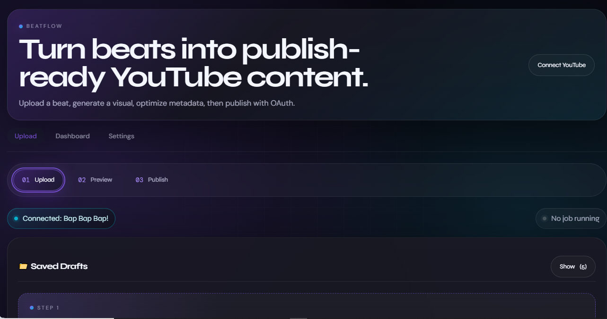
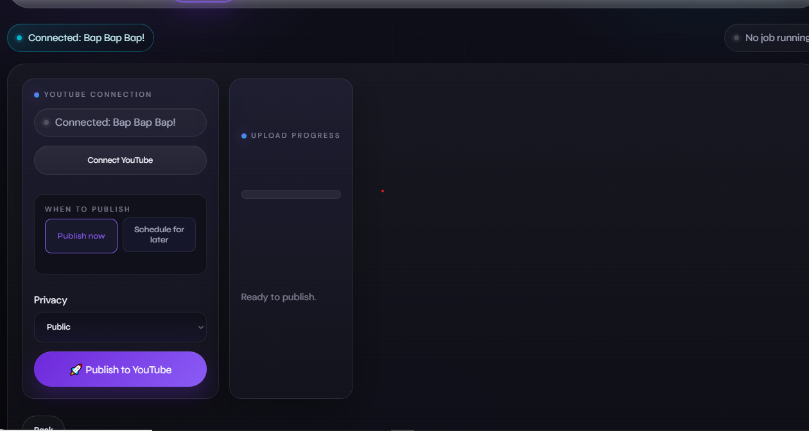

# Beatflow

Beatflow turns a producer's beat upload into a YouTube-ready MP4, SEO metadata, and an OAuth-backed publish flow.

## Screenshot

### 📸 System Interface & Production Analytics

| Production Analytics Dashboard | Application Control Panel |
| :---: | :---: |
|  |  |
| *11.6k Views Automated Growth Analytics* | *Core User Interface Dashboard* |
| **Authentication Flow** | **Metadata Deployment Handler** |
|  |  |
| *OAuth 2.0 Identity Connection Window* | *JSON Payload Parsing & Validation Panel* |

## Prerequisites

- Node.js 20+
- ffmpeg installed system-wide
  - macOS: `brew install ffmpeg`
  - Ubuntu/Debian: `apt install ffmpeg`

## Setup

1. Copy `.env.example` to `.env`.
2. Set Google OAuth client ID, secret, redirect URI, and session secret.
3. Create a Google Cloud project and enable the YouTube Data API v3.
4. Add the redirect URI from `.env` in your OAuth client settings.
5. Run `npm install`.
6. Download the required fonts with `npm run setup:fonts`.
7. Run `npm run dev`.

## Folder Structure

- `server/` Express API, OAuth, metadata, ffmpeg, and upload/publish routes.
- `public/` Vanilla SPA shell, styles, and browser logic.
- `assets/` Static default art for the video preview.
- `temp/` Temporary audio, image, and video files.

## Artist Clip Montage

Beatflow supports an optional video montage feature. Instead of a static thumbnail, you can upload short video clips of the featured artist, and Beatflow will stitch them into a continuous montage that plays throughout the entire beat.

### How it works

- Upload up to 20 video clips (MP4, MOV, or WebM, max 100MB each) in Step 1
- Clips are normalized to a shared format (1920×1080, 30fps, H.264) to ensure reliable concatenation
- The montage is built from 5-second segments, with the rule that no clip plays twice in immediate succession
- If only one clip is uploaded, it loops for the full duration
- If a clip is shorter than a segment, it loops within that segment
- The final video is trimmed to match the beat's exact duration with the beat audio muxed in

### Technical details

- **Normalization**: Every clip is re-encoded to match format before concatenation. This prevents corruption and audio/video sync issues that occur when mixing mismatched codecs or resolutions.
- **Sequencing**: Clips are randomly selected with the constraint that the previous clip cannot be immediately repeated. This ensures visual variety without consecutive duplicates.
- **Error handling**: If one clip fails to normalize, it's skipped with a warning rather than failing the entire montage. If all clips fail, an error is returned.

## Hashtag System

Beatflow uses a highly optimized, context-aware hashtag engine designed for YouTube's 2026 discovery algorithms.

### How it works
- **Exactly 5 Hashtags**: Research shows 3-5 hashtags is optimal. Exceeding 15 hashtags causes YouTube to silently discard **all** of them, penalizing your video. Our engine strictly caps generated hashtags at 5 to ensure you get maximum algorithmic benefit without ever hitting the penalty threshold.
- **Above Title Placement**: The first 3 hashtags receive the heaviest algorithmic weight and appear as clickable links directly above your video title on all devices. 
- **Algorithmic Ordering**: Hashtags are generated in a specific sequence: the most specific anchor signal first (e.g. `#PopcaanTypeBeat`), followed by broader categorization signals, and ending with community tags like `#BeatStars`.
- **Artist Customization**: The system pulls from a curated pool of proven, niche-specific hashtags. If an artist isn't in the default pool, it generates one dynamically. Producers can add artists to `HASHTAG_POOLS.artists` in `server/services/metadata.js` to get custom artist-specific hashtags.

## Production Notes

- Replace the in-memory session store with Redis in production.
- Store OAuth tokens securely.
- Use HTTPS for OAuth redirects outside local development.

## Scripts

- `npm start` Start the server.
- `npm run dev` Start the server with watch mode.
- `npm run clean` Remove temporary files.

## License

MIT
